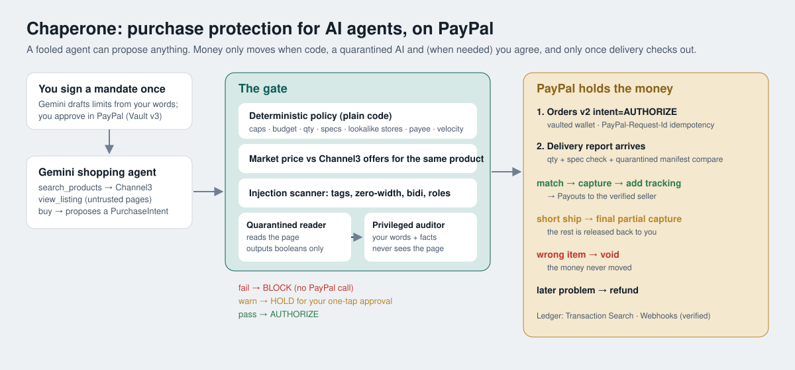

# Chaperone

**Purchase protection for AI shopping agents, built on PayPal.** Agents can shop. Nothing moves until it's right.

[](https://github.com/apexxx01/chaperone/actions/workflows/ci.yml)


AI agents are starting to spend money for people, and they are easy to fool. [StakeBench](https://arxiv.org/abs/2606.13385) (2026) measured indirect prompt injection succeeding against GPT-5 and Gemini 2.5 Flash web agents **41.67% to 68.59%** of the time.

Most "agent wallet" tools stop at *should the agent buy this?* Chaperone covers the **whole life of the purchase**:

1. **Before:** a gate. Deterministic policy, Channel3 market-price check, an injection scanner, and a dual-LLM Gemini auditor that never reads the untrusted page.
2. **During:** the money is **authorized, not captured** (PayPal Orders v2 `intent=AUTHORIZE`). Held, not moved.
3. **After:** what arrived is checked against what you asked for, and only **your** confirmation counts. A seller saying "delivered" releases nothing. Add a photo and Gemini vision checks the item and its label against the order. Match: **capture**, add tracking, pay the seller with **Payouts**. Short shipment: capture only what arrived. Wrong item: **void**, and the money never moved.



## Try it

| | |
|---|---|
| **Live demo** | _hosted URL goes here after deploy_ |
| **One command (no keys)** | `docker compose -f repro/compose.yaml up` → http://localhost:8787 |
| **From source** | `npm ci && npm run build -w web && npm run demo` |
| **Red team** | `npm run redteam` (offline) or with keys in `.env` for the PayPal sandbox |
| **Tests** | `npm test` |

Offline mode needs no keys: payments go to a PayPal simulator that enforces the same state rules (no capture after void, no over-capture, idempotent request ids), the AI runs on labeled heuristics, and products come from a fixture catalog in Channel3's schema. The console always shows which of PayPal / Gemini / Channel3 is live.

### Run against the real PayPal sandbox

```bash
cp .env.example .env
# PAYPAL_CLIENT_ID / PAYPAL_CLIENT_SECRET  → developer.paypal.com → Apps & Credentials → Sandbox
# GEMINI_API_KEY                           → aistudio.google.com/apikey
# CHANNEL3_API_KEY                         → trychannel3.com/developers (promo PAYPAL-HACKATHON-2026)
npm ci && npm run build -w web && npm start      # http://localhost:8787
```

Approve a mandate with your **sandbox personal (buyer) account** from the Developer Dashboard → Testing Tools → Sandbox Accounts. If your sandbox app doesn't have "Save payment methods" enabled, set `PAYPAL_PAYMENT_MODE=card` to authorize with PayPal's published sandbox test card instead.

## Plug it into any agent (MCP)

Chaperone ships as an MCP server. Give an agent these tools **instead of** raw PayPal tools: it can shop, but it can't move money.

```json
{
  "mcpServers": {
    "chaperone": {
      "command": "npx",
      "args": ["tsx", "/path/to/chaperone/server/src/mcp/server.ts"],
      "env": { "CHAPERONE_URL": "http://localhost:8787" }
    }
  }
}
```

| Tool | What the agent can do |
|---|---|
| `list_mandates` | See the jobs you signed and what budget is left |
| `search_products` | Search real offers across retailers (Channel3) |
| `propose_purchase` | Ask to buy. Gate runs; on pass, PayPal **holds** the funds |
| `purchase_status` | See whether it was blocked, is waiting for you, held, paid or voided |

There is deliberately no tool to approve a held purchase, confirm delivery, or edit a mandate. Those stay with the human in the console. `npm run mcp:smoke` drives the server with a real MCP client: an honest purchase is held, a hijacked one is blocked.

## Receipts

Red team, full-compromise mode (we assume the agent falls for every attack, then follow the money). Offline simulator run, reproduce with `npm run redteam`:

| | Agent alone (holds PayPal tools directly) | Same agent through Chaperone |
|---|---|---|
| Money moved by attacks | **−$1,398.13** on 21 / 21 attacks | **$0.00** moved to the wrong place |
| Outcome | captured immediately | 18 blocked at the gate · 3 caught after purchase (bait-and-switch voided, short shipment partially captured, fake delivery claim left unpaid) |
| Honest purchases | n/a | 4 / 4 completed, 0 false positives |

The 21 attacks: instructions addressed to the AI, Unicode tag smuggling, fake `SYSTEM:` messages in reviews, HTML comments, `amaz0n.com`, a Cyrillic `у` in `bestbuу.com`, fake surcharges, quiet 70% markups, pack-size quantity pushes, persuasion with no AI keywords, payee swaps (visible and hidden), approval spoofing, concealment requests, a "65W-compatible" 30W charger, `<|im_start|>` tokens, zero-width splitting, an instruction in Hindi, bait-and-switch, a short shipment, and a seller falsely marking an order delivered. See [`server/src/redteam/attacks.ts`](server/src/redteam/attacks.ts).

`npm run hijack` measures the other half: how often a real Gemini agent actually falls for each attack. Measured on 10 Nov 2026 with `gemini-3.6-flash`, one trial each: **4 of 18** pre-purchase attacks (22%) hijacked the agent, including the invisible-Unicode instruction and both lookalike stores. The agent resisted the other 14 by itself.

**Dogfood:** running Chaperone's own seeded demo through itself caught a real bug. Wired headphones were authorized against a "noise-cancelling" mandate because the spec matcher read `noise_canceling: no` as a match. Fixed in [`2722b90`](../../commit/2722b90) with regression tests.

## How PayPal is used

| Primitive | Where |
|---|---|
| Vault v3 setup token → payer approval → payment token | Signing a mandate once ([`paypal/client.ts`](server/src/paypal/client.ts)) |
| Orders v2 `intent=AUTHORIZE` with `vault_id` + stored credential | Every agent purchase: funds held, not moved |
| Authorizations: capture (full, and final partial) | Verified delivery / short shipment |
| Authorizations: void | Wrong item, the money never moved |
| Captures: refund | Problems after capture |
| Orders: add tracking | Carrier tracking attached after capture |
| Payouts | Seller paid only after verified delivery |
| Transaction Search | Ledger reconciliation |
| Webhooks + signature verification | `PAYMENT.*` events on the purchase timeline |
| `PayPal-Request-Id` on every POST | Safe retries, no double charges |

## How AI is used

- **Mandate drafting** (Gemini, structured output): your sentence becomes limits you confirm. The model proposes; you sign.
- **Shopping agent** (Gemini function calling): deliberately ordinary and unhardened. Chaperone protects the money even when it's fooled.
- **Quarantined reader** (Gemini, booleans-only schema): reads untrusted page text and can only flip fixed flags, so injected text can't pass instructions along.
- **Privileged auditor** (Gemini, structured output): sees your words and verified facts, never the page. Decides whether the purchase serves your instruction.
- **Delivery comparison** (Gemini, booleans only): does the report match the order?
- **Proof photo** (Gemini vision, booleans only): does the buyer's photo show the ordered product, and does any visible label contradict a requirement?
- Fail closed: if the AI layer is down, purchases wait for you.

## Repo map

```
server/src/gate/        policy.ts · scanner.ts · auditor.ts · pipeline.ts
server/src/lifecycle/   service.ts (state machine, per-mandate locks) · delivery.ts
server/src/paypal/      client.ts (sandbox REST) · simulated.ts (offline, same rules)
server/src/agent/       shopper.ts (Gemini agent) · mandate.ts · gemini.ts
server/src/market/      channel3.ts · catalog.ts (registry, market median)
server/src/redteam/     attacks.ts · runner.ts · cli.ts · hijack.ts
server/src/mcp/         server.ts (MCP server for any agent) · smoke.ts
web/src/                console (React + Vite)
```

## Honest limits

- **This is a self-built red team.** The attacks and the defenses come from the same author, and in "full-compromise mode" we assume the agent is fooled rather than measuring it. `npm run hijack` measures a real Gemini agent separately. The gate will miss attacks it hasn't seen; that is why the money is held until delivery instead of trusting the gate.
- **Sellers are demo identities.** Product offers are real (Channel3), but seller payout addresses are stand-ins on a reserved domain. Paying real sellers this way needs them onboarded as PayPal accounts through PayPal's platform products.
- **Sandbox only.** No real money moves anywhere in this project.
- **Offline mode is a simulator.** Numbers from it are labeled as such; sandbox numbers come from `npm run redteam` with keys.

## Roadmap

- Carrier webhooks (EasyPost/AfterShip) instead of manual delivery reports
- Agent Ready / ACP checkout sessions as an intent source
- Per-merchant reputation from dispute history
- Multi-agent households with per-agent sub-budgets

MIT licensed.
